## 👋 Hi, I'm Cuthbert

Software Engineer @ Beijing · Nacos Committer [@alibaba](https://github.com/alibaba) | AI Coding Enthusiast | iOS Indie Dev

- Open source contributor, focused on [Nacos](https://github.com/alibaba/nacos) — multi-language SDK, code quality governance & CI/CD
- Exploring AI-assisted coding workflows
- Indie iOS developer, shipped [MomentGif](https://github.com/cxhello/MomentGif)
- Java / Python / Go / Swift · Kubernetes · Observability
- ⚽ Football · 🎸 Rock · 🎮 Gaming · 🏃 Sports

## 🖥️ Recently Activity

<!--START_SECTION:activity-->
1. ℹ️ Assigned issue [#162](https://github.com/nacos-group/nacos-sdk-nodejs/issues/162) in [nacos-group/nacos-sdk-nodejs](https://github.com/nacos-group/nacos-sdk-nodejs)
2. 💪 Opened PR [#164](https://github.com/nacos-group/nacos-sdk-nodejs/pull/164) in [nacos-group/nacos-sdk-nodejs](https://github.com/nacos-group/nacos-sdk-nodejs)
3. 🎉 Merged PR [#163](https://github.com/nacos-group/nacos-sdk-nodejs/pull/163) in [nacos-group/nacos-sdk-nodejs](https://github.com/nacos-group/nacos-sdk-nodejs)
4. 🗣 Commented on [#541](https://github.com/nacos-group/nacos-k8s/pull/541#issuecomment-6674888853) in [nacos-group/nacos-k8s](https://github.com/nacos-group/nacos-k8s)
5. 💪 Opened PR [#163](https://github.com/nacos-group/nacos-sdk-nodejs/pull/163) in [nacos-group/nacos-sdk-nodejs](https://github.com/nacos-group/nacos-sdk-nodejs)
6. 🗣 Commented on [#162](https://github.com/nacos-group/nacos-sdk-nodejs/issues/162#issuecomment-6649183244) in [nacos-group/nacos-sdk-nodejs](https://github.com/nacos-group/nacos-sdk-nodejs)
7. 🗣 Commented on [#150](https://github.com/nacos-group/nacos-sdk-nodejs/issues/150#issuecomment-6627021193) in [nacos-group/nacos-sdk-nodejs](https://github.com/nacos-group/nacos-sdk-nodejs)
8. ℹ️ Labeled issue [#162](https://github.com/nacos-group/nacos-sdk-nodejs/issues/162) in [nacos-group/nacos-sdk-nodejs](https://github.com/nacos-group/nacos-sdk-nodejs)
9. ❗ Opened issue [#162](https://github.com/nacos-group/nacos-sdk-nodejs/issues/162) in [nacos-group/nacos-sdk-nodejs](https://github.com/nacos-group/nacos-sdk-nodejs)
10. 🎉 Merged PR [#66](https://github.com/nacos-group/nacos-sdk-proto/pull/66) in [nacos-group/nacos-sdk-proto](https://github.com/nacos-group/nacos-sdk-proto)
<!--END_SECTION:activity-->

## 📊 GitHub Stats

