## 👋 Hi, I'm Cuthbert

Software Engineer @ Beijing · Nacos Committer [@alibaba](https://github.com/alibaba) | AI Coding Enthusiast | iOS Indie Dev

- Open source contributor, focused on [Nacos](https://github.com/alibaba/nacos) — multi-language SDK, code quality governance & CI/CD
- Exploring AI-assisted coding workflows
- Indie iOS developer, shipped [MomentGif](https://github.com/cxhello/MomentGif)
- Java / Python / Go / Swift · Kubernetes · Observability
- ⚽ Football · 🎸 Rock · 🎮 Gaming · 🏃 Sports

## 🖥️ Recently Activity

<!--START_SECTION:activity-->
1. 🗣 Commented on [#537](https://github.com/nacos-group/nacos-k8s/issues/537#issuecomment-6212577041) in [nacos-group/nacos-k8s](https://github.com/nacos-group/nacos-k8s)
2. 🗣 Commented on [#226](https://github.com/nacos-group/nacos-k8s/issues/226#issuecomment-6210101362) in [nacos-group/nacos-k8s](https://github.com/nacos-group/nacos-k8s)
3. 🗣 Commented on [#537](https://github.com/nacos-group/nacos-k8s/issues/537#issuecomment-6210705110) in [nacos-group/nacos-k8s](https://github.com/nacos-group/nacos-k8s)
4. 🗣 Commented on [#260](https://github.com/nacos-group/nacos-k8s/issues/260#issuecomment-6210100344) in [nacos-group/nacos-k8s](https://github.com/nacos-group/nacos-k8s)
5. 🎉 Merged PR [#538](https://github.com/nacos-group/nacos-k8s/pull/538) in [nacos-group/nacos-k8s](https://github.com/nacos-group/nacos-k8s)
6. ❗ Opened issue [#539](https://github.com/nacos-group/nacos-k8s/issues/539) in [nacos-group/nacos-k8s](https://github.com/nacos-group/nacos-k8s)
7. 💪 Opened PR [#526](https://github.com/nacos-group/nacos-docker/pull/526) in [nacos-group/nacos-docker](https://github.com/nacos-group/nacos-docker)
8. 🔒 Closed issue [#537](https://github.com/nacos-group/nacos-k8s/issues/537) in [nacos-group/nacos-k8s](https://github.com/nacos-group/nacos-k8s)
9. ❗ Opened issue [#537](https://github.com/nacos-group/nacos-k8s/issues/537) in [nacos-group/nacos-k8s](https://github.com/nacos-group/nacos-k8s)
10. 💪 Opened PR [#538](https://github.com/nacos-group/nacos-k8s/pull/538) in [nacos-group/nacos-k8s](https://github.com/nacos-group/nacos-k8s)
<!--END_SECTION:activity-->

## 📊 GitHub Stats

